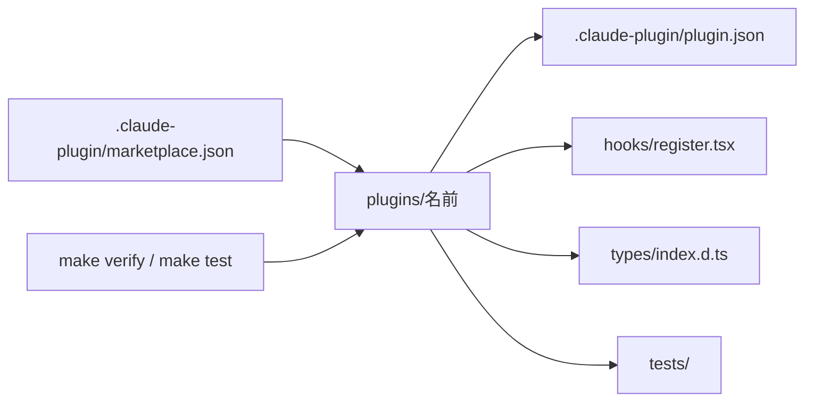

# claude-plugins

自作の Claude Code のプラグインと mod を置くマーケットプレイス。


## ✨ 機能

| プラグイン | できること |
| --- | --- |
| [pr-browser](plugins/pr-browser/README.md) | `gh pr create` で作った PR のページを、[terminal-browser](https://github.com/zenbu-labs/terminal-browser) で右に開く。会話が 128 列より狭い時は下に開く |
| [snapshot-gallery](plugins/snapshot-gallery/README.md) | `make snapshot` で描いた PNG を、直す前と後で左右に並べて pane に出す。`/snapshots <セット>` で開き、`j` と `k` で前と次に移る |
| [session-dashboard](plugins/session-dashboard/README.md) | モデル・版・費用・リポジトリ・利用の上限・今の作業（動いているサブエージェントも）・文脈の埋まり具合を右の pane に出し、閉じている間は入力欄の上に出す。キャッシュが切れるまでの時間も出す。Tokyo Night の色で、題を罫線に埋めた表にして出す。アイコンに Nerd Font を使う |
| [test-progress](plugins/test-progress/README.md) | テストのコマンドの間、進みの棒と落ちたテストを入力欄の上に出し、終わったらトーストで知らせる。コマンドの出力を `.build/test.log` に残しておく |

## 🗺️ 全体像



## 💻 実行環境

| 道具 | 版 | 使う所 |
| --- | --- | --- |
| Claude Code | 2.1.319 | プラグインの実行、`claude plugin validate`、`claude plugin test` |
| TypeScript | 5.4 以上 | `make types` での型の検査 |
| jq | | `make verify` の version と description の検査 |
| terminal-browser | | pr-browser |
| macOS | | snapshot-gallery の `shasum`・`sips`・`open` |

## 🚀 入れ方

1. マーケットプレイスを足す。

   ```sh
   /plugin marketplace add yossibank/claude-plugins
   ```

2. プラグインを入れて、読み込む。

   ```sh
   /plugin install <プラグイン>@yossibank
   /reload-plugins
   ```

   context-gauge を入れていた時は、`/plugin uninstall context-gauge@yossibank` で外してから session-dashboard を入れる。
   session-dash を入れていた時は、`/plugin uninstall session-dash@yossibank` で外してから session-dashboard を入れる。

3. pr-browser を使う時は、terminal-browser を入れる。

   ```sh
   brew install terminal-browser
   ```

## 📚 文書

| 知りたいこと | 文書 |
| --- | --- |
| 全リポジトリ共通の決まり | [claude-config](https://github.com/yossibank/claude-config) |
| 作業の進め方 | [CLAUDE.md](CLAUDE.md) |

## 🛠️ 足し方

1. `plugins/<名前>/` に、`.claude-plugin/plugin.json`・`hooks/`・`tests/` を置く。
2. `plugin.json` の `version` は `0.1.0` にする。
3. `tsconfig.json` を置く。中身は、ほかのプラグインと同じ `extends` の 1 行にする。
4. `claude --plugin-dir plugins/<名前>` で読み込む。`.claude-plugin/types/` ができる。git には入れない。
5. 状態の型は `types/index.d.ts` に書き、`plugin.json` の `types` で指す。
6. `.claude-plugin/marketplace.json` の `plugins` に足す。`description` は `plugin.json` と同じにする。
7. プラグインの README を置き、機能の表に行を足す。
8. `make verify` と `make test` で確かめる。`tsc` があれば `make types` も通す。

```json
{ "extends": "./.claude-plugin/types/tsconfig.json" }
```

## 📏 版の上げ方

| 変えたもの | `plugin.json` の `version` で上げる所 | 例 |
| --- | --- | --- |
| 設定の名前を消す・替える、前の動きが残らない変更 | 2 つ目 | `0.1.0` → `0.2.0` |
| 機能を足す、不具合を直す | 3 つ目 | `0.1.0` → `0.1.1` |
| 文書・テストだけ | 上げない | |

1. `plugin.json` の `version` を上げて、PR をマージする。
2. `/plugin marketplace update yossibank` で、マーケットプレイスを更新する。
3. `/reload-plugins` で、読み込み直す。
