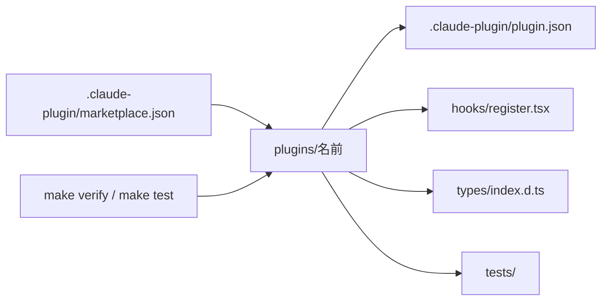

# claude-plugins

自作の Claude Code のプラグインと mod を置くマーケットプレイス。


## ✨ 機能

| プラグイン | できること |
| --- | --- |
| [pr-browser](plugins/pr-browser/README.md) | `gh pr create` で作った PR のページを、[terminal-browser](https://github.com/zenbu-labs/terminal-browser) で右に開く。会話が 128 列より狭い時は下に開く |
| [snapshot-gallery](plugins/snapshot-gallery/README.md) | `make snapshot` で描いた PNG を、直す前と後で左右に並べて pane に出す。`/snapshots <セット>` で開き、`j` と `k` で前と次に移る |
| [session-dashboard](plugins/session-dashboard/README.md) | モデル・バージョン・費用・リポジトリ・利用の上限・今の作業・文脈の埋まり具合を右の pane に出す。閉じている間は入力欄の上に出す |
| [test-progress](plugins/test-progress/README.md) | テストのコマンドの間、進みの棒と落ちたテストを入力欄の上に出し、終わったらトーストで知らせる。コマンドの出力を `.build/test.log` に残しておく |
| [handoff](plugins/handoff/README.md) | 文脈が埋まってきたら、右のペインで引き継ぎを勧める。引き継ぎメモを `.claude/handoff.md` に書き、`/clear` した新しい会話の入力欄に入れる |

## 🗺️ 全体像



## 💻 実行環境

| 道具 | バージョン | 使う所 |
| --- | --- | --- |
| Claude Code | 2.1.319 | プラグインの実行、`claude plugin validate`、`claude plugin test` |
| TypeScript | 5.4 以上 | `make types` での型の検査 |
| jq | 最新 | `make verify` の version と description の検査 |
| terminal-browser | 最新 | pr-browser |
| macOS | — | snapshot-gallery の `shasum`・`sips`・`open` |

## 🚀 入れ方

```sh
/plugin marketplace add yossibank/claude-plugins
/plugin install <プラグイン>@yossibank
/reload-plugins
```

| プラグイン | 先に入れるもの |
| --- | --- |
| pr-browser | `brew install terminal-browser` |

## 📚 文書

| 文書 | 読む時 | 中身 |
| --- | --- | --- |
| [docs/development.md](docs/development.md) | プラグインを足す・バージョンを上げる時 | 置くファイル、足し方、バージョンの上げ方 |
| [CLAUDE.md](CLAUDE.md) | 作業する時 | 確認のコマンド、コードの書き方 |
| [claude-config](https://github.com/yossibank/claude-config) | 全リポジトリの決まりを知る時 | 共通の決まり |
